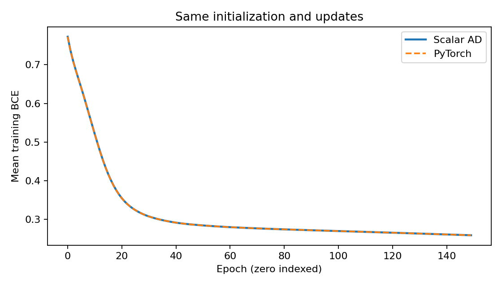

# Lab 5 - Frameworks and automatic differentiation

This is a runnable preparation example. Review the choices and explanations before using it in class.

## Gradient correctness

24 coordinates of the manual's expression were tested in float64. Maximum absolute error: PyTorch **0.000e+00**, central differences **1.623e-10**. Both are below 1e-6. Epsilon was 1e-6.

The scalar engine uses one Value per element and sums the eight output Values. ReLU after a square cannot exercise a negative ReLU input, so independent tests cover negative, zero and positive ReLU inputs, reused nodes, duplicate edges, a deep graph, and all 33 model-parameter gradients.

## Tiny model and training speed

2 -> 8 (ReLU) -> 1 (sigmoid), probability-space BCE, full-batch SGD, learning rate 0.5, 150 epochs. make_moons: 160 points, noise 0.15, stratified 70/30 split, seed 42. NumPy default_rng(42) initializes first-layer weights from N(0, 0.6**2) and second-layer weights from N(0, 0.4**2); all biases are zero. These hyperparameters and the hidden ReLU are explicit choices where the manual is silent.

Both engines start from identical 33 parameters for every run; use identical data, float64 CPU arithmetic, loss reduction, updates and epoch count. Five timed runs alternate engine order, after two untimed warm-up epochs on throwaway models. Data/model/optimizer setup and evaluation are outside timing; forward, backward and SGD updates are inside. Both record per-epoch loss; scalar graph disposal and final garbage collection are included.

| Engine | Median training time |
|---|---:|
| Scalar AD | 9.459442 s |
| PyTorch eager | 0.058081 s |

PyTorch was 162.87x faster. Final parameter difference: 8.882e-16; test accuracy: 89.58%; final train BCE: 0.258160. This comparison includes Python scalar objects versus vectorized native tensor operations; it does not isolate the cost of autodiff alone.

## Execution modes

Inference uses the same trained model, float64 CPU inputs and one PyTorch thread. Each input shape is warmed up separately (20 calls per variant), then measured in seven blocks of 300 calls with alternating order. The table reports median time per call; raw blocks are retained. Every variant's outputs are checked against eager. Training timings above are a separate experiment.

| Batch | Eager (us) | Traced (us) | Compiled (us) |
|---:|---:|---:|---:|
| 1 | 11.720 | 8.805 | unsupported |
| 32 | 12.259 | 9.971 | unsupported |
| 256 | 17.889 | 14.886 | unsupported |

Selected main comparison: **traced**. Trace creation: 0.036150 s.

Compilation failed; tracing is the manual-approved fallback. Diagnostic: `BackendCompilerFailed: backend='inductor' raised: InvalidCxxCompiler: No working C++ compiler found in torch._inductor.config.cpp.cxx: (None, 'g++')`.

Tracing was 1.20x to 1.33x as fast as eager across the measured batches. The compilation probe uses an explicit forward function and verifies graph capture, because a returning callable alone is insufficient evidence of compilation.

### Short note: when compilation helps

Compilation can help when repeated work saves enough interpreter/dispatch or kernel cost to repay setup. Stable shapes and many small operations can provide opportunities; a tiny model can instead be dominated by wrapper and guard overhead. For this run, use the measured speedup rather than assuming compilation wins. The break-even estimate is N > setup_time / (eager_time - optimized_time), only when the denominator is positive; changing shapes or graph breaks can add setup again. This is an interpretation of the experiment, not a general performance guarantee.

Tracing records the path exercised by example inputs. This model has no data-dependent Python branch. Tracing an if-statement on tensor values would require separate correctness analysis. FX forward, autograd backward and TorchScript graphs are saved separately: they serve different purposes.

## Tensor layout

The strided view is backing[:, ::2], shape (1024, 1024), float64, stride (2048, 2). Its contiguous copy has identical element values and stride (1024, 1). The view shares the backing storage; the copy owns different storage. View creation and the initial copy are excluded from direct-operation timing; copy-only and copy-plus-operation are separately measured.

| Variant | Median sin(x).sum() time (ms) |
|---|---:|
| contiguous | 2.6902 |
| noncontiguous_view | 3.6531 |
| copy_then_operation | 4.2173 |
| copy_only | 1.3192 |

The strided-view/direct-contiguous ratio is 1.358x. This is a measured layout effect for one operation and one shape. Allocation, cache behavior, stride-aware kernels and internal copies can change the result for other operations. Copying is worthwhile only if later savings repay the copy.

## Evidence and limits

`results/environment.json` records the actual interpreter, versions, CPU, device, threads and timestamp. CSV files preserve every training run and timing block. No GPU synchronization is needed because all measured tensors are on CPU. Wall-clock results are sensitive to system load; seven blocks are descriptive samples, not confidence intervals. This 160-point dataset is an instructional example, not a broad model-quality evaluation.

Manual: `references/Lab Manual_ Labs 05.pdf`, printed page 7. Reading links and a worked chain-rule example are in `study_guide.md`. This preparation does not establish attendance or replace the opening classroom instructions.
