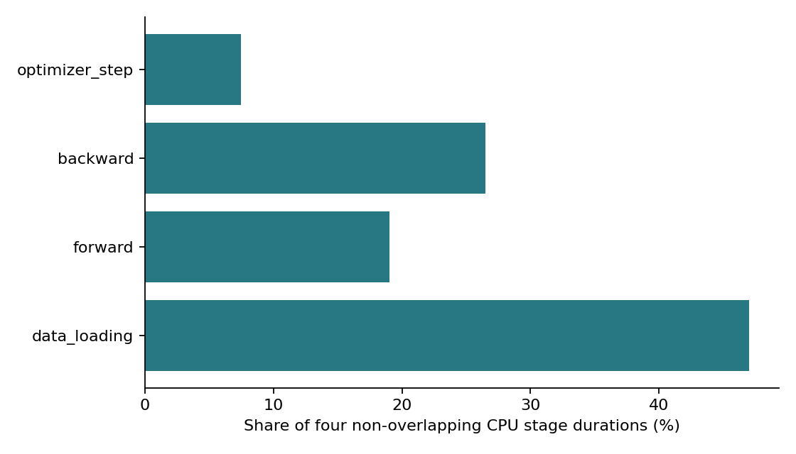
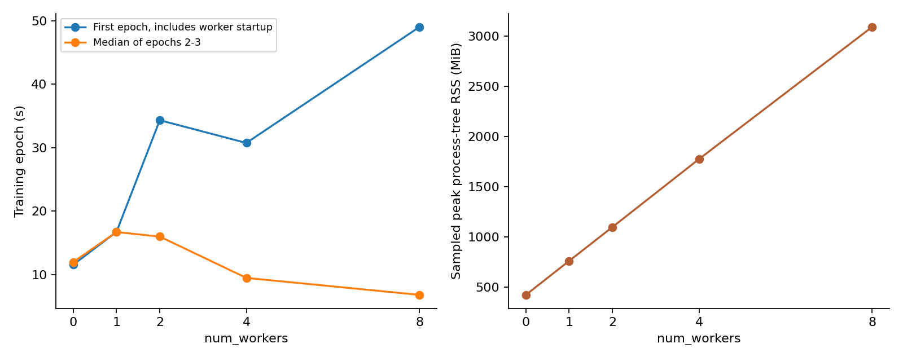
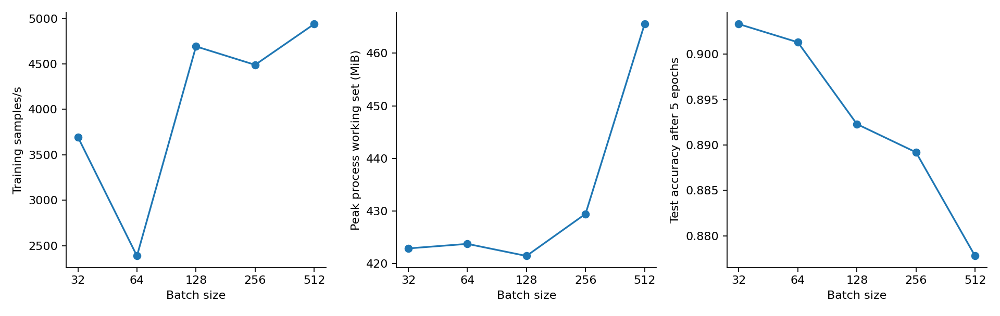
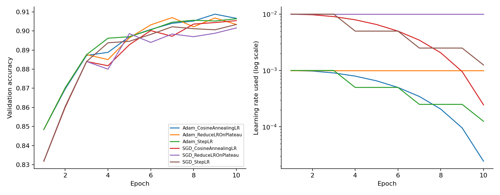
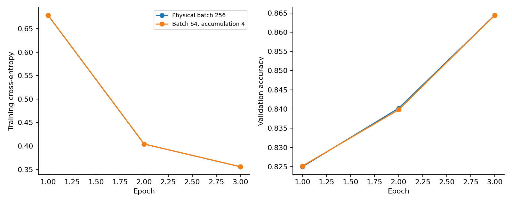
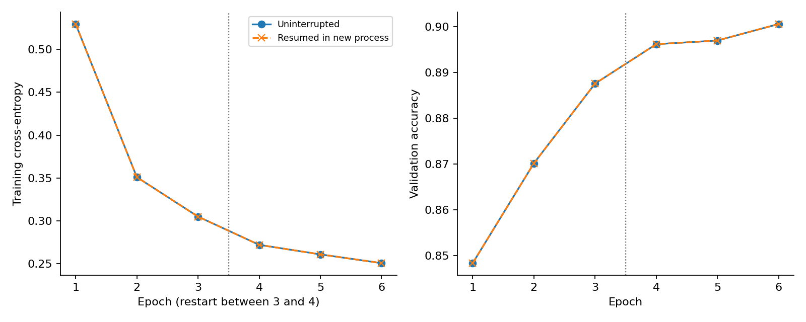

# Lab 6: Training pipelines and project proposal

**Student:** G M Robi Farhan Rojob | **ID:** 73997 | **Course:** CII5SE039CI, Group 01

## Goal and provenance

Restructure the best Lab 3 architecture into one YAML-driven reproducible pipeline, measure its bottlenecks, and demonstrate accumulation and restart recovery. The unchanged Lab 3 CNN has 20,490 parameters (Conv 1->16; pool; Conv 16->32; pool; Linear 1568->10). It had the highest Lab 3 validation accuracy (89.60%) and test accuracy (89.17%); the source summary and split are in references. This lab reinitializes that architecture with seed 42 for every independent comparison rather than continuing different pretrained states.

## Method

Fashion-MNIST: all 60,000 official training examples split 55,000/5,000 using random_split seed 42, identical to Lab 3; 10,000 official test examples remain separate. ToTensor and Normalize(mean=0.2860,std=0.3530), no augmentation. Raw data are loaded before training timers; conversion, normalization, collation and iterator waits are inside data-loading time. All runs use float32 CPU, four intra-operation threads, one inter-operation thread and deterministic algorithms. Python, NumPy, Torch, sampler and workers are seeded. All study values and budgets come from config.yaml; effective overrides are logged. Every independent experiment runs sequentially in a fresh Python process, avoiding competing CPU benchmarks and making process memory more comparable. No subset or early stopping is used.

Adam starts at 0.001 with default betas; SGD uses lr=0.01 and momentum=0.9; weight decay is zero. These fixed learning rates are declared choices, not separately tuned optima. StepLR halves lr every three epochs. CosineAnnealingLR has T_max=10 and eta_min=0. ReduceLROnPlateau monitors validation loss (factor 0.5, patience 1, relative threshold 0.001). Schedulers step after validation; the logged lr is the rate actually used in that epoch, and next_lr is distinguished. Six optimizer/scheduler combinations each receive exactly 10 epochs. Only batch-size runs use the official test set, once at the end of each required five-epoch run; scheduler comparisons and selection use validation only.

Throughput is training samples divided by measured training-loop wall time, including iterator startup, transformations, forward/loss, backward, updates and batch scoring. Validation, checkpoint serialization, MLflow writes and process startup are excluded; this is training throughput, not job completion throughput. Profiling overhead is excluded from all study results. Jobs execute in the explicit plan order, without randomized repeated timing blocks; background load and thermal changes may affect rankings. Memory is CPU process memory, not CUDA allocation or model-weight size: batch studies report Windows' native process peak working set in fresh processes; sampled main RSS, baseline/increment and process-tree RSS are also retained. RSS includes interpreter, libraries, dataset, tensors and allocator caching. Sampling is every 20 ms and can miss brief peaks; process-tree sums may double-count shared pages. Native peak includes setup and final evaluation. CPU/GPU figures must not be interchanged.

## 1. YAML, checkpoints and MLflow

main.py derives the full study from one config object and launches src/pipeline.py. Every run logs YAML/effective parameters, per-epoch loss, accuracy, lr, throughput, timing, checkpoints, source and evidence artifacts into genuine local MLflow records. There are 21 current completed runs; the interrupted run resumes under the same MLflow ID. The offline experiment_dashboard.html and mlflow_export.json expose the records without a server. mlflow-skinny 2.14.1 provides the actual MLflow tracking client/FileStore APIs; the web UI/server is not installed. The full course requirements are preserved elsewhere; its unrelated mlflow/pyarrow conflict is avoided by this explicit tracking-only subset. requirements-lock.txt records actual installed versions. Each epoch checkpoint stores model, optimizer, scheduler, Python/NumPy/Torch RNG, loader generator, epoch, history, effective config and MLflow ID.

## 2. Full-epoch PyTorch profile

One complete epoch (55,000 samples, 430 batches) is captured by torch.profiler on CPU. Non-overlapping record_function ranges enclose next(iterator), forward plus cross-entropy, backward, and gradient normalization/optimizer step/zeroing. The inclusive CPU duration of each labelled parent range includes its child operators; summing all nested operator totals would double-count. The four-stage shares below sum to 100%; the separate epoch-wall shares leave Python scoring/loop overhead outside those four stages. This is elapsed time of CPU ranges, not aggregate work across all cores. Iterator construction is charged to the first data-loading range.

| phase | seconds | share_of_four_phases_pct | share_of_epoch_wall_pct |
| --- | --- | --- | --- |
| data_loading | 6.485 | 46.982 | 46.674 |
| forward | 2.628 | 19.040 | 18.915 |
| backward | 3.658 | 26.498 | 26.324 |
| optimizer_step | 1.033 | 7.480 | 7.431 |

The unassigned epoch-wall residual is 0.091 seconds. Full operator table: profile_operators.txt; compressed Chrome trace: profile_trace.json.gz (decompress to inspect in a compatible trace viewer).

## 3. DataLoader worker study

Each worker count trains three complete epochs at batch 128. The first includes Windows spawn/startup and warm-up; the median of epochs 2-3 is the steady measurement with persistent workers. A median of two values is their arithmetic midpoint. No disk image reads occur per batch: Fashion-MNIST raw arrays are already in memory. Worker count trades parallel per-sample processing against IPC, memory and CPU contention; eight workers do not mean eight times the throughput. The first-epoch shuffle is identical across worker counts. In later epochs, zero-worker and persistent-worker loaders consume their shared seed generator differently, so their sample orders and trained weights can differ. Every epoch still processes exactly the same 55,000 examples through a fixed-cost dense CNN; this worker study compares time and memory, not accuracy. Each individual setting is reproducible.

| num_workers | cold_epoch_seconds | steady_epoch_seconds | steady_samples_per_second | steady_data_wait_seconds | peak_tree_rss_mib |
| --- | --- | --- | --- | --- | --- |
| 0 | 11.52 | 11.96 | 4599.57 | 5.14 | 422.75 |
| 1 | 16.71 | 16.68 | 3327.15 | 0.37 | 761.07 |
| 2 | 34.31 | 15.97 | 3507.49 | 0.38 | 1098.70 |
| 4 | 30.73 | 9.45 | 5845.41 | 0.24 | 1776.09 |
| 8 | 49.02 | 6.78 | 8121.01 | 0.18 | 3093.27 |

Best observed steady epoch uses 8 workers. At zero workers, data loading is the largest profiled stage. Extra workers reduce input wait, shifting the limit toward computation and IPC. Compare the stage timings and worker curve together: more workers can remove input wait yet add IPC and memory cost. With only two steady epochs and one seed, close timing rankings are observations on this computer, not proof of a universal optimum.

## 4. Batch size: five full epochs each

Worker count stays zero, Adam/no schedule, same starting state and epoch shuffle sequence. Batch size changes update count as well as memory and arithmetic utilization; an equal epoch budget does not mean an equal optimizer-update budget. Final partial batches are retained.

| batch_size | epochs | samples_per_second | peak_rss_mib | validation_accuracy | test_accuracy |
| --- | --- | --- | --- | --- | --- |
| 32 | 5 | 3695.8 | 422.9 | 90.26% | 90.33% |
| 64 | 5 | 2386.8 | 423.7 | 90.28% | 90.13% |
| 128 | 5 | 4692.5 | 421.4 | 89.64% | 89.23% |
| 256 | 5 | 4489.6 | 429.4 | 89.18% | 88.92% |
| 512 | 5 | 4938.3 | 465.6 | 88.16% | 87.78% |

Each test accuracy has denominator 10,000; raw correct counts and memory increments are in batch_study.csv. Accuracy and memory need not vary monotonically: optimization paths, convolution workspaces and allocator reuse matter.

## 5. Optimizer and learning-rate schedule: equal ten-epoch budgets

| optimizer | scheduler | epochs | final_validation_loss | final_validation_accuracy | initial_lr | final_used_lr |
| --- | --- | --- | --- | --- | --- | --- |
| Adam | CosineAnnealingLR | 10 | 0.2601 | 90.66% | 0.001000 | 0.000024 |
| Adam | ReduceLROnPlateau | 10 | 0.2599 | 90.34% | 0.001000 | 0.001000 |
| Adam | StepLR | 10 | 0.2634 | 90.64% | 0.001000 | 0.000125 |
| SGD | CosineAnnealingLR | 10 | 0.2733 | 90.54% | 0.010000 | 0.000245 |
| SGD | ReduceLROnPlateau | 10 | 0.2700 | 90.16% | 0.010000 | 0.010000 |
| SGD | StepLR | 10 | 0.2756 | 90.34% | 0.010000 | 0.001250 |

Highest observed final validation accuracy: Adam + CosineAnnealingLR (90.66%). This comparison includes the declared starting learning rates and one seed, so it does not establish an optimizer's inherent superiority. A plateau scheduler is conditional: it may keep the same rate if validation loss continues improving. See per-epoch lr and next_lr records rather than assuming every schedule changes lr every epoch.

## 6. Gradient accumulation

Compare physical batch 256 to micro-batch 64 accumulated four times, using SGD+momentum, the same sample order, initialization and three-epoch budget. Sum cross-entropy gradients over a group, divide by the actual number of examples, then step once. The last effective group contains 216 examples (not 256), so blindly dividing every mean micro-loss by four would be wrong. Both paths make 215 updates per epoch. There are no BatchNorm/dropout layers whose behavior would otherwise differ with micro-batch size.

Maximum training-loss difference: 4.381e-05; maximum validation-accuracy difference: 4.000e-04; maximum final parameter difference: 2.953e-03. Similar-behavior check (loss difference <0.02 and accuracy difference <=1 percentage point): **True**. Float32 reduction order can create small differences; an independent float64 linear-model check includes an uneven final group and matches within 1e-14.

## 7. Real process interruption after epoch three

An uninterrupted six-epoch Adam+StepLR run is the reference. A separate process trains epochs 1-3, writes checkpoint_epoch3.pt and exits. A fresh Python process restores the complete state and trains epochs 4-6 under the same MLflow run ID. The checkpoint is saved after scheduler.step, so epoch four uses the correct next learning rate. Epoch metrics 1-3 are preserved and metrics 4-6 append without re-running earlier epochs.

Maximum final parameter difference: 0.000e+00; per-curve maximum differences: {"train_loss": 0.0, "train_accuracy": 0.0, "validation_loss": 0.0, "validation_accuracy": 0.0, "lr": 0.0, "next_lr": 0.0}. Exact state/curve match: **True**. Timing fields are intentionally excluded from equality because execution time varies. The exact recovery demonstration uses zero workers and deterministic transforms; stochastic worker-local state and prefetched queues would require additional handling. This verifies recovery at an epoch boundary; a mid-batch interruption would need sampler position and any accumulated gradients as well.

## 8. Individual project proposal

project_proposal.pdf is a separate one-page proposal with name and ID. The revised project, **ROJOB - Lightweight Fabric Defect Detection for Garment Quality Control**, proposes an AITEX normal-versus-defective classification baseline, compact U-Net-style defect segmentation and INT8 evaluation. Original images are partitioned before patch extraction to prevent leakage. Targets are defect recall >=90%, image-level macro-F1 >=0.85, defective-patch Dice >=0.60, p95 CPU latency <=50 ms per 256 x 256 patch and an inference artifact <=5,000,000 bytes. These are proposed acceptance criteria; the completed Fashion-MNIST pipeline experiments do not evaluate the new project. Instructor approval remains pending.

## Conclusions

1. The largest profiled stage is data_loading (47.0% of the four labelled stages). Worker tuning must consider startup, steady time and whole-process memory together.
2. Batch size and learning-rate policy change both efficiency and optimization. Select using validation and deployment constraints; freeze project choices before the final project test evaluation.
3. Correct accumulation needs actual sample weighting, and reproducible resumption needs optimizer, scheduler and RNG/shuffle state as well as model weights. Both are backed by independent checks and full-dataset comparisons here.

## References and scope

- Supplied Lab Manual, Lab 6, printed page 8; copied to references. Its instructions define the assignment and do not authorize publication or imply instructor approval.
- Supplied Reddi textbook, July 31, 2025: section 5.5 pp.215-218; chapter 8 pp.385-468, especially 8.4 pp.408-422, 8.5 pp.422-439 and 8.7 pp.457-460; section 13.3 pp.859-875. Viewer page = printed page +52. See reference_record.json and study_guide.md.
- [MLflow 2.14.1 tracking documentation](https://mlflow.org/docs/2.14.1/tracking.html) and installed tracking/FileStore APIs.
- [PyTorch 2.3 profiler](https://docs.pytorch.org/docs/2.3/profiler.html), [DataLoader](https://docs.pytorch.org/docs/2.3/data.html), and installed 2.3.1 implementations.

AI-assisted preparation with measured evidence. Personal understanding, prescribed reading, attendance, instructor approval and any eventual submission remain student actions. Earlier labs are preserved.
