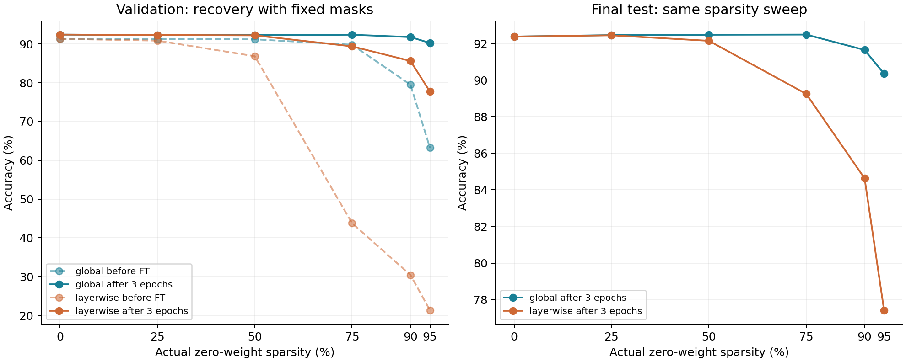
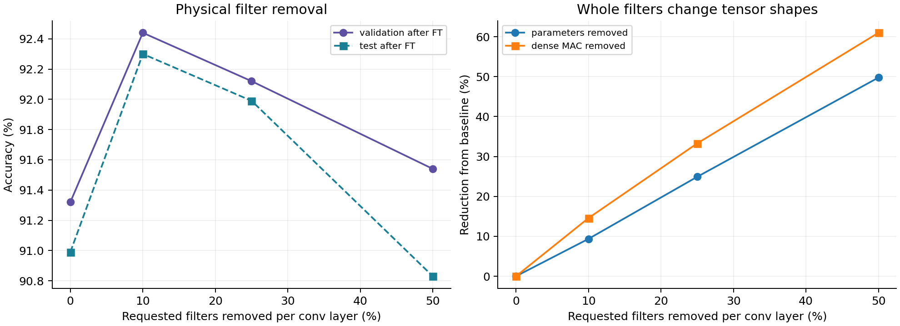
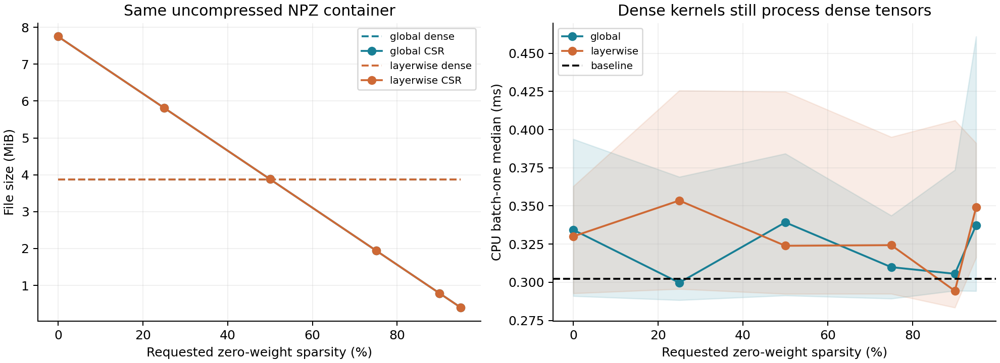
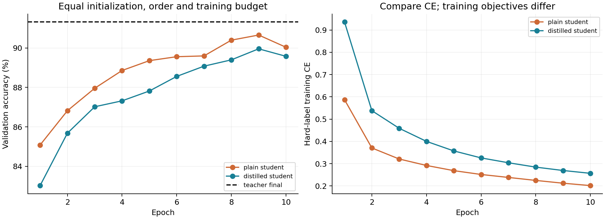
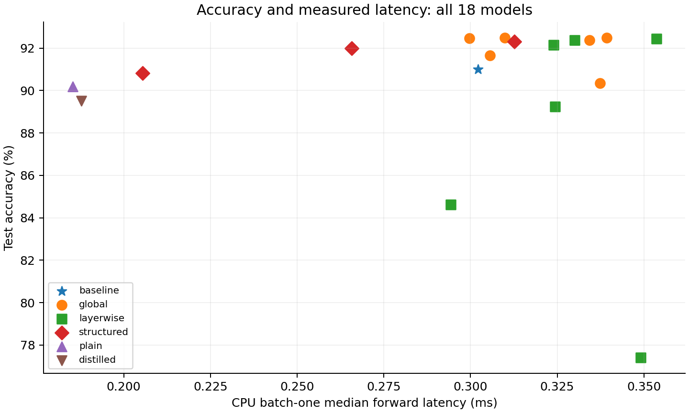

# Lab 7: Compression - pruning and distillation

**Student:** G M Robi Farhan Rojob | **ID:** 73997 | **Course:** CII5SE039CI, Group 01

## Goal and evidence

Compare global, layer-wise and physical structured pruning with a compact student, trained with and without a teacher. These are full-data measurements from this CPU, not anticipated results. Eighteen models complete 75 epochs (10 baseline + 36 unstructured fine-tuning + 9 structured fine-tuning + 20 student). The manual's bracketed task marks sum to 115; this report retains all five tasks without rescaling them.

## Method and reproducibility

Fashion-MNIST has 60,000 official training and 10,000 test images. The seed-42 permutation splits training into 55,000/5,000; split_indices.npz records exact indices, matching the Lab 3/6 random_split convention. Pixels are divided by 255 and normalized with mean 0.2860/std 0.3530. Normalized FP32 tensors are cached once in RAM; this avoids per-example conversion overhead. No augmentation, subset or extra labelled data is used. This setup differs from Lab 6's timed transforms, so training speeds across labs should not be directly ranked.

Hardware: **Intel(R) Core(TM) Ultra 9 285H** (Windows, exact platform/build in environment.json). CPU FP32, four intra-op threads, one inter-op thread, deterministic algorithms, seed 42. Every model processes 55,000 images per epoch in 430 batches (batch 128, final batch 88). Each independent training call resets its sample-order generator to 43. Adam uses lr 0.001 for fresh teacher/student training and 0.0001 for fine-tuning; default betas, zero weight decay, no scheduler or early stopping. The final fixed-budget epoch supplies each model. All hyperparameters were fixed before observing these test results; validation is logged before/after pruning and every epoch. The test set measures the required comparisons after each final model; it never drives optimization or mask selection. One seed is used, so small accuracy gaps do not establish significance.

Code/config fingerprints, versions, architecture, initial-parameter hashes, checkpoint hashes, epoch logs and exact split indices are recorded. Running main.py continues complete fingerprint-matching experiments; an interrupted experiment restarts from its beginning. Use --rerun for deliberate retraining. Repeated invocation refreshes final timing; latency is expected to vary.

## 1. Oversized baseline [15]

Teacher: Conv(1,16,3,pad1)-ReLU-MaxPool2; Conv(16,32,3,pad1)-ReLU-MaxPool2; Flatten; Linear(1568,640)-ReLU-Linear(640,10). No BatchNorm or dropout. The parameter count is 160 + 4,640 + 1,004,160 + 6,410 = **1,015,370**. The large hidden layer deliberately puts most parameters in the dense head. Ten epochs produce **90.99% test accuracy**.

Inference-only model.pt stores architecture and state, without optimizer or pruning reparameterizations. Dense/CSR NPZ files below are a separate like-for-like storage comparison.

## 2. Controlled pruning and recovery [35]

Global pruning sorts absolute weights across all convolutional/linear weight tensors. Layer-wise pruning ranks within each tensor. Biases remain trainable and are excluded from the pruning denominator. Targets are exactly 0, 0.25, 0.5, 0.75, 0.9 and 0.95. We remove round(target * eligible weights), with stable flattened-index tie-breaking. Layer-wise rounding occurs independently per tensor; actual sparsity is reported. Each point starts from the same trained teacher, receives a new optimizer, and fine-tunes three full epochs at 0.0001. This is a one-shot independent sweep, not iterative pruning or cumulative training.

Masked gradients and post-update projection both preserve fixed zeros; assertions check for regrowth after every epoch. Saved masks and per-layer sparsities support verification. The 0% cases are three-epoch dense fine-tuning controls; they have three more epochs than the original baseline. Validation curves distinguish immediate pruning damage from recovery. Final test curves compare all frozen outcomes.

Structured pruning independently ranks each original convolution's output filters by L2 norm and removes round(target * filters) at 10%, 25% and 50%. Retained filters stay in original index order. Conv1 outputs/Conv2 inputs, Conv2 outputs and corresponding fc1 input columns are physically sliced, together with convolution biases. Integer rounding means requested filter removal can differ slightly from actual per-layer removal. The classifier hidden width stays 640. The compact model is checked against a dense network with removed filter outputs zeroed before fine-tuning; all differences must be below 2e-4. It then receives the same three-epoch fine-tuning recipe. Its remaining tensors are dense, so its zero-weight fraction is near zero: removed filters are absent, not stored zeros. Filter removal, parameter reduction and zero-weight sparsity are separate quantities.

## 3. Storage, hardware latency and compute [15]

| Model | Test % | Parameters | Zero weights % | Dense / CSR MiB | MAC M | b1 p50 / p95 ms |
| --- | --- | --- | --- | --- | --- | --- |
| teacher | 90.99 | 1,015,370 | 0.00 | 3.875 / 7.752 | 2.026 | 0.302 / 0.550 |
| global_0 | 92.38 | 1,015,370 | 0.00 | 3.875 / 7.752 | 2.026 | 0.334 / 0.593 |
| global_0.25 | 92.46 | 1,015,370 | 25.00 | 3.875 / 5.817 | 2.026 | 0.300 / 0.548 |
| global_0.5 | 92.48 | 1,015,370 | 50.00 | 3.875 / 3.881 | 2.026 | 0.339 / 0.577 |
| global_0.75 | 92.49 | 1,015,370 | 75.00 | 3.875 / 1.946 | 2.026 | 0.310 / 0.527 |
| global_0.9 | 91.65 | 1,015,370 | 90.00 | 3.875 / 0.785 | 2.026 | 0.306 / 0.618 |
| global_0.95 | 90.35 | 1,015,370 | 95.00 | 3.875 / 0.398 | 2.026 | 0.337 / 0.629 |
| layerwise_0 | 92.38 | 1,015,370 | 0.00 | 3.875 / 7.752 | 2.026 | 0.330 / 0.569 |
| layerwise_0.25 | 92.45 | 1,015,370 | 25.00 | 3.875 / 5.817 | 2.026 | 0.354 / 0.635 |
| layerwise_0.5 | 92.15 | 1,015,370 | 50.00 | 3.875 / 3.881 | 2.026 | 0.324 / 0.587 |
| layerwise_0.75 | 89.25 | 1,015,370 | 75.00 | 3.875 / 1.946 | 2.026 | 0.324 / 0.558 |
| layerwise_0.9 | 84.63 | 1,015,370 | 90.00 | 3.875 / 0.785 | 2.026 | 0.294 / 0.547 |
| layerwise_0.95 | 77.42 | 1,015,370 | 95.00 | 3.875 / 0.398 | 2.026 | 0.349 / 0.585 |
| structured_0.1 | 92.30 | 920,313 | 0.00 | 3.513 / 7.027 | 1.731 | 0.313 / 0.531 |
| structured_0.25 | 91.99 | 762,426 | 0.00 | 2.910 / 5.822 | 1.352 | 0.266 / 0.470 |
| structured_0.5 | 90.83 | 510,058 | 0.00 | 1.948 / 3.897 | 0.790 | 0.206 / 0.383 |
| student_plain | 90.20 | 103,018 | 0.00 | 0.395 / 0.791 | 0.384 | 0.185 / 0.335 |
| student_distilled | 89.52 | 103,018 | 0.00 | 0.395 / 0.791 | 0.384 | 0.188 / 0.430 |

Dense NPZ stores all FP32 coefficients, including zeros. Custom CSR flattens each weight tensor to (output channels, remaining dimensions), stores nonzero FP32 values, int32 column indices/row pointers and int32 shape metadata; biases remain dense. Both files use the same **uncompressed** NPZ container. Every sparse file is decoded and compared bit-for-bit with its dense weights. Architecture is in model.pt/summary. File sizes include container headers; model.pt has its own measured byte count in comparison.csv. MiB = 1,048,576 bytes. Stored masks are training evidence and excluded from inference-file sizes.

For an m-by-n FP32 matrix, dense payload is 4mn bytes, whereas this CSR payload is approximately 8*nnz + 4*(m+1) bytes plus shape/container metadata. Index overhead means CSR can exceed dense storage at low sparsity; crossing roughly 50% sparsity is only a payload approximation. At 90% global sparsity, dense storage is 3.875 MiB and CSR is 0.785 MiB. Restoring CSR to dense for inference does not preserve its RAM savings; no sparse execution speed is claimed.

Benchmark: CPU eager PyTorch, eval plus inference_mode, pre-created contiguous normalized inputs, batches 1 and 128, same four threads. Five blocks independently shuffle model order with seed 142. Before each model/block/batch, 30 warm-up calls run. Each block records 100 individual batch-one calls or 20 batch-128 calls using perf_counter_ns. Reported p50/p95 pool 500/100 calls per model; latency_blocks.csv retains block medians and order, latency_raw.csv every observation. Timings include Python dispatch and tensor allocation inside forward, and exclude preprocessing, data transfer, disk I/O, model loading and argmax. Inputs are reused and models remain resident; this is warm forward latency, not a cold-start or production request SLA. Synchronous CPU calls need no CUDA synchronization. Background scheduling, cache and thermal effects can alter close rankings; p95 is descriptive, not a confidence interval. Shaded bands show minimum/maximum block medians, not statistical confidence.

Unstructured pruning retains identical tensor shapes and dense kernels: the baseline and global-90% model both require 2,025,984 nominal dense MAC per image. Their observed batch-one medians are 0.302 and 0.306 ms. Any difference here cannot be credited to skipping zero multiplies because this execution path does not skip them. Real sparse acceleration needs compatible kernels, a suitable sparsity pattern and enough work to repay index/gather overhead. Physically compact structured-50% uses 790,400 MAC and measures 0.206 ms, versus the baseline 0.302 ms. Reduced MAC counts still need hardware measurement to establish a benefit.

MAC counts cover convolution and linear weight multiplies per image (biases, activations and pooling excluded); FLOPs use 2 per multiply-add. potential_nonzero_mac is an idealized zero-skipping count, not executed CPU work. Parameter sparsity can differ from MAC sparsity because a convolution weight is reused at many spatial positions. Batch-128 throughput, p50/p95 and all file sizes are in comparison.csv.

## 4. Plain and distilled student [30]

Student: conv channels 8 and 16, flatten 784, hidden width 128, ten classes. Parameter count = 80 + 1,168 + 100,480 + 1,290 = **103,018**. Both students start from bit-identical weights, use identical epoch orders/Adam settings, and train for ten epochs. Plain loss is hard-label cross entropy. The teacher is frozen in eval mode, and its logits are cached **only for the 55,000 training images**, taking 4.27 seconds and 2,200,000 bytes. Cache preparation is an extra distillation cost, excluded from student epoch timing. Teacher training and cache generation must be included when considering lifecycle cost; they are not needed during student inference.

The manual explicitly writes KL(p_student || p_teacher), which is the reverse of the common teacher-target KL(p_teacher || p_student). This implementation follows the manual literally:

`p_s = softmax(student_logits / 4); log_p_t = log_softmax(teacher_logits / 4)`

`KL = mean_over_batch(sum_over_classes(p_s * (log_p_s - log_p_t)))`

`loss = 0.5 * CE(student_logits, labels) + 0.5 * 4^2 * KL`

Teacher logits are detached; the student probability term remains differentiable, including its entropy. Class contributions are summed and examples averaged. PyTorch's usual kl_div(log_student, teacher_probs, reduction='batchmean') would compute the other direction. This choice is documented for instructor discussion instead of silently changing the supplied equation. A numerical gradient check tests the literal direction. Temperature 4 softens relative class scores; T^2 compensates the temperature-dependent gradient scale. At inference, the student uses its ordinary logits without the teacher or temperature adjustment.

| Model | Val % | Test % | Parameters | Dense MiB | b1 p50 ms | Train loop s |
| --- | --- | --- | --- | --- | --- | --- |
| teacher | 91.32 | 90.99 | 1,015,370 | 3.875 | 0.302 | 178.5 |
| student_plain | 90.04 | 90.20 | 103,018 | 0.395 | 0.185 | 65.8 |
| student_distilled | 89.58 | 89.52 | 103,018 | 0.395 | 0.188 | 68.8 |

The distilled-minus-plain test difference is **-0.68 percentage points** (-68 correctly classified images out of 10,000). This is the observed result for the stated manual-direction loss and one fixed seed. Distillation is not guaranteed to improve accuracy. Both students have the same deployment shape, MAC count and storage; training differences cannot intrinsically make one execute a different number of dense operations.

## 5. Efficiency pillars and conclusion [20]

The table uses the manual's data/model/compute/energy organization. In this textbook edition, section 9.3 explicitly names algorithmic, compute and data efficiency; energy and sustainability also enter the broader system trade-offs. Here model is the compression/representation view, and energy is reported separately as required by the laboratory.

| Model | Data: labels and image exposures | Model: params; dense/CSR | Compute: MAC; b1; training loop | Energy: estimated at 35 W |
| --- | --- | --- | --- | --- |
| teacher | 55k labels; 550,000 exposures | 1,015,370; 3.875/7.752 MiB | 2.026 M; 0.302 ms; 178.5 s | 10.57 mJ; 1.781 Wh |
| global_0 | 55k labels; +165,000 FT exposures | 1,015,370; 3.875/7.752 MiB | 2.026 M; 0.334 ms; 54.8 s | 11.70 mJ; 0.548 Wh |
| global_0.25 | 55k labels; +165,000 FT exposures | 1,015,370; 3.875/5.817 MiB | 2.026 M; 0.300 ms; 48.5 s | 10.49 mJ; 0.483 Wh |
| global_0.5 | 55k labels; +165,000 FT exposures | 1,015,370; 3.875/3.881 MiB | 2.026 M; 0.339 ms; 46.1 s | 11.87 mJ; 0.459 Wh |
| global_0.75 | 55k labels; +165,000 FT exposures | 1,015,370; 3.875/1.946 MiB | 2.026 M; 0.310 ms; 47.4 s | 10.85 mJ; 0.473 Wh |
| global_0.9 | 55k labels; +165,000 FT exposures | 1,015,370; 3.875/0.785 MiB | 2.026 M; 0.306 ms; 47.0 s | 10.69 mJ; 0.468 Wh |
| global_0.95 | 55k labels; +165,000 FT exposures | 1,015,370; 3.875/0.398 MiB | 2.026 M; 0.337 ms; 46.7 s | 11.81 mJ; 0.467 Wh |
| layerwise_0 | 55k labels; +165,000 FT exposures | 1,015,370; 3.875/7.752 MiB | 2.026 M; 0.330 ms; 46.4 s | 11.55 mJ; 0.463 Wh |
| layerwise_0.25 | 55k labels; +165,000 FT exposures | 1,015,370; 3.875/5.817 MiB | 2.026 M; 0.354 ms; 45.9 s | 12.37 mJ; 0.458 Wh |
| layerwise_0.5 | 55k labels; +165,000 FT exposures | 1,015,370; 3.875/3.881 MiB | 2.026 M; 0.324 ms; 47.3 s | 11.34 mJ; 0.471 Wh |
| layerwise_0.75 | 55k labels; +165,000 FT exposures | 1,015,370; 3.875/1.946 MiB | 2.026 M; 0.324 ms; 45.4 s | 11.35 mJ; 0.452 Wh |
| layerwise_0.9 | 55k labels; +165,000 FT exposures | 1,015,370; 3.875/0.785 MiB | 2.026 M; 0.294 ms; 43.2 s | 10.30 mJ; 0.430 Wh |
| layerwise_0.95 | 55k labels; +165,000 FT exposures | 1,015,370; 3.875/0.398 MiB | 2.026 M; 0.349 ms; 42.8 s | 12.21 mJ; 0.426 Wh |
| structured_0.1 | 55k labels; +165,000 FT exposures | 920,313; 3.513/7.027 MiB | 1.731 M; 0.313 ms; 42.1 s | 10.94 mJ; 0.419 Wh |
| structured_0.25 | 55k labels; +165,000 FT exposures | 762,426; 2.910/5.822 MiB | 1.352 M; 0.266 ms; 36.1 s | 9.30 mJ; 0.360 Wh |
| structured_0.5 | 55k labels; +165,000 FT exposures | 510,058; 1.948/3.897 MiB | 0.790 M; 0.206 ms; 27.3 s | 7.19 mJ; 0.272 Wh |
| student_plain | 55k labels; 550,000 exposures | 103,018; 0.395/0.791 MiB | 0.384 M; 0.185 ms; 65.8 s | 6.49 mJ; 0.657 Wh |
| student_distilled | 55k labels/logits; 550,000 exposures | 103,018; 0.395/0.791 MiB | 0.384 M; 0.188 ms; 68.8 s | 6.57 mJ; 0.686 Wh |

**Energy is not measured.** The fixed-power scenarios 15/35/65 W are illustrative assumptions, not CPU TDP readings, telemetry or confidence bounds. Inference estimate E_mJ = P_W * latency_ms. Training estimate E_Wh = P_W * training-plus-validation wall_seconds / 3600. The table shows 35 W; all three scenarios are saved. Cache generation at 35 W would add 0.0416 Wh and teacher preparation must also be counted. Data preparation, process startup, final test, serialization and failed/verification work are excluded from these estimates; whole-job energy is therefore not established. Actual power can differ by model, load and time, so latency-scaled estimates cannot prove energy savings or emissions reductions. A power meter or calibrated platform energy counter would be needed.

1. Global pruning trades zero-weight storage against accuracy. At 90%, it reaches 91.65% test accuracy and a 4.94x dense-to-CSR file-size ratio, while leaving dense execution shapes unchanged.
2. Physical structured pruning and the compact student reduce dense tensor dimensions and nominal work. Structured-50% retains 90.83% test accuracy with 49.8% fewer parameters. Measure latency on the target deployment device before selecting a model; storage, MAC and latency rankings need not match.
3. The student uses 9.86x fewer parameters than the teacher. Distillation changes its test accuracy by -0.68 points in this run and incurs teacher preparation cost. These measurements support a device-specific accuracy/size/latency decision, with energy still requiring direct measurement.

## Sources and review

Lab Manual: Labs 07, printed page 9, preserved in references/. The supplied Reddi textbook edition is July 31, 2025; Chapter 9 is printed pp. 479-540 (viewer 531-592), section 10.3 pp. 547-550 (viewer 599-602), and section 10.4 pp. 550-584 (viewer 602-636). Boundaries include following headings; pruning begins p.551, distillation p.565. This edition calls 10.4 Model Representation Optimization. Source hashes and reading map are in reference_record.json. The study guide includes official PyTorch references and oral-practice questions.

This is AI-assisted preparation with measured evidence. Review the choices and conclusions so you can explain them during class. No submission or instructor approval is claimed.
